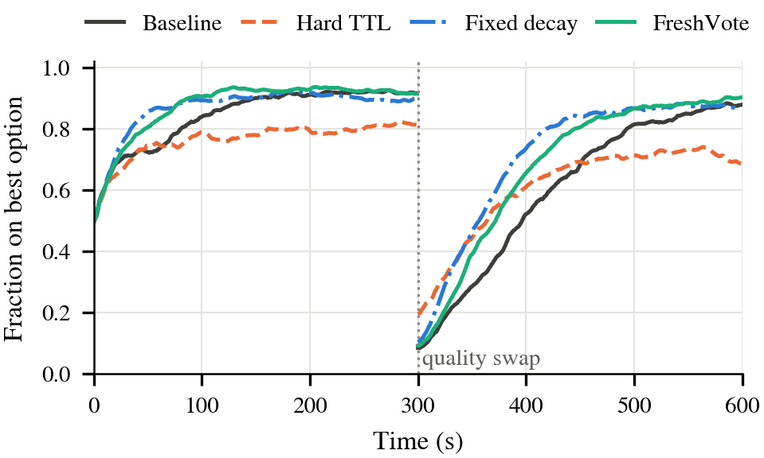
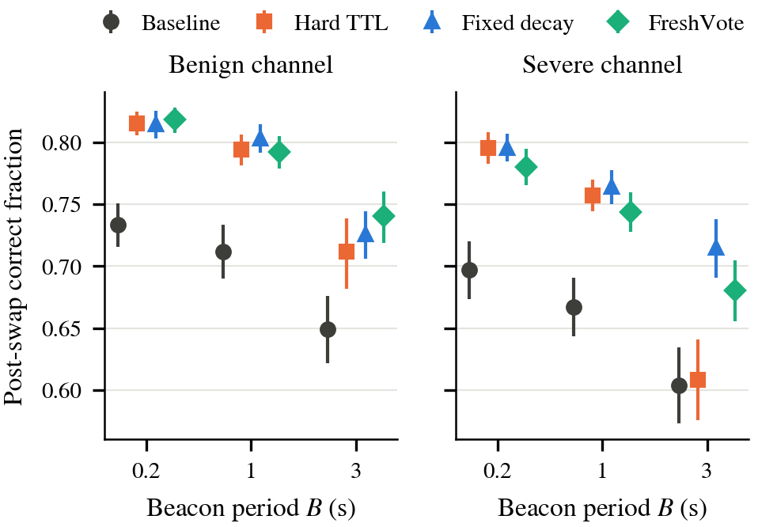
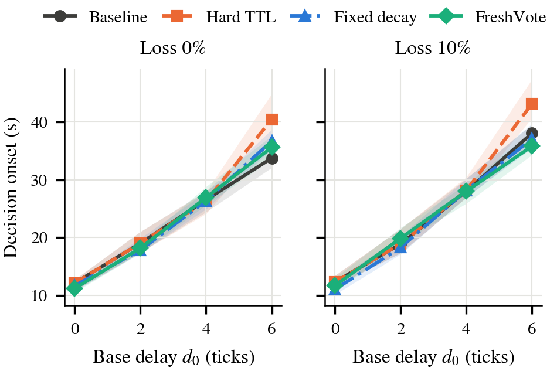

# FreshVote

**Adaptive receiver-side message freshness for swarm decisions under delayed and cached communication**

Hazem Eissa and Thant Minn Htet, School of Computer Science and Engineering, University of Sunderland, UK

> **Paper.** Submitted to the 7th IEEE International Workshop on Communication and Networking for Swarm Robotics (ROBOCOM 2027), held with IEEE CCNC 2027.
> A link to the paper and a citation entry will be added here if the paper is accepted.
> <!-- TODO after acceptance: replace with the IEEE Xplore link / DOI, e.g.
> **Paper:** [FreshVote: ... (ROBOCOM 2027)](https://doi.org/10.1109/XXXX) -->

---

## About the Project

Robots in a swarm often act on opinions that were broadcast some time earlier. By the time a vote is used, its sender may have changed its mind or the environment may have changed. This repository asks a simple question: **when should a robot weight a received vote by how old it is?**

**FreshVote** is a receiver-side weighting rule for a weighted-voter swarm. Each message carries its send time, so the receiver knows its age `a = t - s`. From the ages it has recently seen, the receiver computes the median `m` and interquartile range `h`, and weights each candidate message as

```
w = q * exp(-λ·a) * 1[a <= Θ],    λ = ln 2 / max(m, 1),    Θ = max(2, m + κ·h)
```

where `q` is the sender's (distance-attenuated) confidence. A message of typical age gets half weight, and messages far older than the local age scale are ignored. No global clock model or network-wide delay estimate is needed, and the rule does not change if all ages grow by a common factor.

FreshVote is compared with three alternatives on identical seeds:

| Policy | Weight |
|---|---|
| Baseline (age-unaware) | `w = q` |
| Hard TTL | `w = q * 1[a <= Θ]` |
| Fixed decay | `w = q * exp(-λ·a)` |
| **FreshVote** | `w = q * exp(-λ_i·a) * 1[a <= Θ_i]`, with `λ_i`, `Θ_i` set from the receiver's own age history |

The simulator models 100 mobile ground robots in a 200 × 400 m field with heterogeneous obstacles, 25 m line-of-sight links, distance-dependent delay, bounded jitter and packet loss, choosing between two options of quality 0.60 and 0.75.

## Two experiments and two answers

**Experiment 1: streaming votes, fixed option qualities (3,840 held-out runs).** Every neighbour broadcasts every 0.1 s tick and votes are used on arrival. All four policies reached correct consensus in every run, and FreshVote changed decision time by −0.12 s (95% CI [−0.69, 0.44]). Candidate ages differ by only a few ticks, so age carries almost no information. Delay itself still costs about 3.9 s of decision time per tick of base delay, but no receiver-side rule can remove that floor.

**Experiment 2: neighbour cache, periodic beacons, mid-run quality swap (960 held-out runs).** Robots beacon every 0.2, 1 or 3 s, keep the latest message from each neighbour (up to 60 s), and the option qualities swap at t = 300 s. Here age matters:

| Policy | Post-swap correct fraction [95% CI] | Δ vs baseline [95% CI] | Median recovery (s) | Runs not recovered |
|---|---|---|---|---|
| Baseline | 0.677 [0.667, 0.687] | — | 249 | 84 / 240 |
| Hard TTL (Θ = 20 ticks) | 0.747 [0.739, 0.755] | +0.070 [0.058, 0.082] | 127 | 53 / 240 |
| Fixed decay (λ = 0.10 /tick) | 0.770 [0.763, 0.776] | +0.093 [0.082, 0.103] | 129 | 25 / 240 |
| FreshVote (κ = 0.5) | 0.759 [0.752, 0.766] | +0.082 [0.071, 0.094] | 144 | 20 / 240 |

A hard TTL tuned at a 1 s beacon period fails at 3 s over a severe channel (it accepts only about a quarter of cached votes and does no better than the baseline), while FreshVote keeps its benefit without retuning (+0.073 over the TTL, 95% CI [0.037, 0.109]). A tuned fixed decay was slightly more accurate than FreshVote overall (+0.010, [0.003, 0.018]); FreshVote's advantage is robustness to the beacon rate rather than peak accuracy.

<p align="center">
  
  
</p>
<p align="center">
  
</p>

All parameters were tuned on training seeds and frozen before the held-out runs (Experiment 1: seeds 1-20 → 21-60; Experiment 2: seeds 101–115 → 201–240). The Experiment 2 calibration condition is not part of its test grid, so every test cell measures transfer.

## Repository layout

```
FreshVote/
├── code/                         simulator and experiment runners
│   ├── sim.py                    Experiment 1 simulation loop (streaming votes)
│   ├── sim_cache.py              Experiment 2 simulation (neighbour cache, beacons, quality swap)
│   ├── consensus.py              baseline / hard TTL / fixed decay / FreshVote policies (Exp. 1)
│   ├── agent.py comms.py config.py dynamics.py failures.py metrics.py terrain.py
│   ├── run_freshvote_calibration.py   Exp. 1 calibration (seeds 1-20)
│   ├── run_freshvote_evaluation.py    Exp. 1 held-out evaluation (seeds 21-60)
│   ├── run_freshvote_smoke.py         small end-to-end check (not evidence)
│   ├── run_cache_experiment.py        Exp. 2 calibration and evaluation
│   └── tests/                    47 unit tests
├── results/                      archived run-level data used in the paper (+ SHA256SUMS.txt)
│   ├── calibration_full/         Exp. 1 calibration runs and selection record
│   ├── evaluation_full_local/    Exp. 1 held-out runs (3,840 rows) and manifest
│   └── cache_experiment/         Exp. 2 calibration (195 rows), evaluation (960 rows), manifest
├── analysis/
│   ├── validate_evaluation.py    integrity checks for Exp. 1
│   ├── analyze_primary.py        Exp. 1 statistics (Wilson intervals, paired bootstrap)
│   ├── primary/ validation/      Exp. 1 analysis outputs
│   ├── revision/                 Exp. 2 analysis and all paper figures
│   └── exp2/                     Exp. 2 analysis outputs
├── figures/                      figures as used in the paper (PDF + PNG)
├── requirements.txt
└── CITATION.cff
```

## Installation

Python 3.10 or newer.

```bash
git clone https://github.com/hazemone/FreshVote.git
cd FreshVote
python3 -m venv .venv
source .venv/bin/activate          # Windows: .venv\Scripts\activate
pip install -r requirements.txt
```

Single-threaded numerical libraries are recommended for reproducible timing and results:

```bash
export OMP_NUM_THREADS=1 OPENBLAS_NUM_THREADS=1 MKL_NUM_THREADS=1
```

## Quick start

```bash
cd code
python -m pytest -q                 # expect: 47 passed
python sim_cache.py                 # two Experiment 2 runs (baseline, FreshVote), ~10 s
python run_freshvote_smoke.py       # tiny Experiment 1 matrix, writes results/smoke/ (not evidence)
```

## Regenerating the paper's tables and figures from the archived data

No simulation is needed; this takes under a minute.

```bash
# Experiment 1
python analysis/validate_evaluation.py \
  --manifest results/evaluation_full_local/evaluation_manifest.json \
  --csv results/evaluation_full_local/evaluation_runs.csv \
  --log results/evaluation_full_local.log \
  --output-dir analysis/validation
python analysis/analyze_primary.py \
  --input results/evaluation_full_local/evaluation_runs.csv \
  --output-dir analysis/primary
python analysis/revision/fig_exp1.py

# Experiment 2 (prints all numbers quoted in the paper, writes analysis/exp2/*.csv and figures/)
python analysis/revision/analyze_exp2.py
python analysis/revision/fig_exp2_series.py 30 severe --plot-only
```

## Re-running the experiments

A single run takes roughly 5–10 s (Experiment 2) or about 1 min (Experiment 1) on one core. Set `--workers` to the number of available cores.

**Experiment 1** (3,840 runs; about 2 h on 32 cores):

```bash
cd code
python run_freshvote_calibration.py --workers 32            # 260 training runs -> results/calibration/
python run_freshvote_evaluation.py --workers 32 | tee ../results/evaluation_full.log
                                                            # 3,840 held-out runs -> results/evaluation_full/
```

The frozen settings (Θ = 9, λ = 0.35, κ = 1.5) are fixed in `run_freshvote_evaluation.py`. The runner refuses seeds that overlap the calibration range.

**Experiment 2** (195 calibration + 960 held-out runs; under 10 min on 32 cores):

```bash
cd code
python run_cache_experiment.py calibrate --workers 32
python run_cache_experiment.py evaluate --workers 32 --ttl 20 --lam 0.10 --kappa 0.5
cd ..
python analysis/revision/analyze_exp2.py
python analysis/revision/fig_exp2_series.py 30 severe 32    # re-runs one cell and checks it against the CSV
```

Both new runs write to `results/` next to the archived data; the analysis scripts read the archived paths shown above, so point them at your new files to compare.

## Reproducibility notes

- Runs are deterministic for a fixed software stack. Re-running the Experiment 2 cell used for Fig. 3 reproduced every stored value exactly.
- Exact trajectories depend on the NumPy/Python build: an Experiment 1 run repeated under a different NumPy version can differ at the individual-run level, while aggregate results are stable. The archived data were produced with Python 3.12.3 / NumPy 2.5.3 (Experiment 1) and Python 3.11 / NumPy 2.4.4 (Experiment 2).
- In Experiment 2, all four policies share the same motion, channel and cache random streams for a given seed, so policy comparisons are exactly paired.
- `results/SHA256SUMS.txt` lists checksums of the archived CSVs; verify with `cd results && sha256sum -c SHA256SUMS.txt`.
- Calibration and smoke outputs are training or diagnostic data only and are never pooled with held-out results.

## Citation

If the paper is accepted, please cite it. Until then, cite this repository (see `CITATION.cff`):

```bibtex
@misc{eissa2026freshvote,
  author       = {Eissa, Hazem and Htet, Thant Minn},
  title        = {{FreshVote}: Adaptive Receiver-Side Message Freshness for Swarm Decisions
                  Under Delayed and Cached Communication},
  year         = {2026},
  howpublished = {\url{https://github.com/hazemone/FreshVote}},
  note         = {Code and data. Paper submitted to ROBOCOM 2027 (IEEE CCNC 2027 workshop)}
}
```

<!-- TODO after acceptance: replace with the proceedings entry, e.g.
@inproceedings{eissa2027freshvote,
  author    = {Eissa, Hazem and Htet, Thant Minn},
  title     = {...},
  booktitle = {Proc. IEEE Consumer Communications and Networking Conference (CCNC), ROBOCOM Workshop},
  year      = {2027},
  doi       = {10.1109/XXXX}
}
-->

## License

To be decided by the authors before the repository is made public.

## Contact

Hazem Eissa (hazemone@hotmail.com, hazem.eissa@sunderland.ac.uk), School of Computer Science and Engineering, University of Sunderland, UK.
Thant Minn Htet (azurawhiston@gmail.com, bj22hr@student.sunderland.ac.uk), School of Computer Science and Engineering, University of Sunderland, UK.
